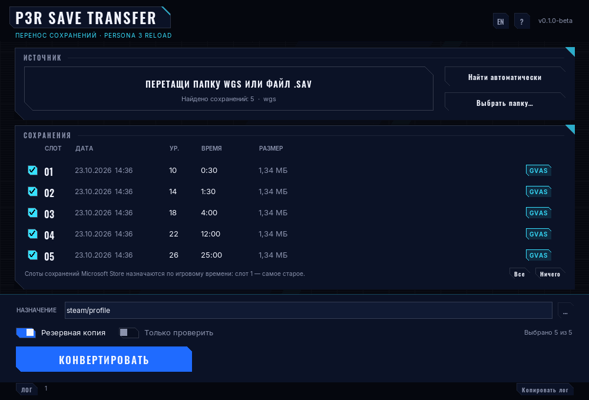
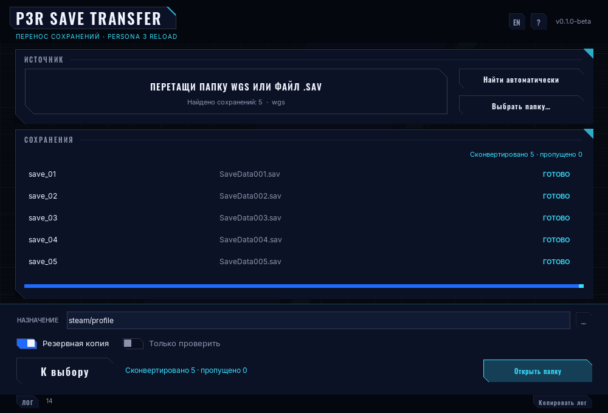

# P3R Save Transfer Tool

[](https://github.com/Thunderouse/p3r-save-transfer/actions/workflows/ci.yml)
[](https://github.com/Thunderouse/p3r-save-transfer/releases)
[](LICENSE)

Перенос сохранений **Persona 3 Reload** из версии Microsoft Store / Xbox Game Pass
в Steam, чтобы продолжить прохождение после покупки игры в Steam.

[English version](README.md) · [Changelog](CHANGELOG.md) · [Notice](NOTICE.md)

Утилита меняет только **обёртку**: снимает (или ставит) ту простую обфускацию,
которой Steam-версия закрывает обычный Unreal-контейнер `GVAS`. Содержимое
сохранения - прогресс, инвентарь, соцлинки, персоны - не редактируется и не
изменяется. Каталог Microsoft Store открывается только на чтение.

```
MS Store:  <файл с мусорным именем>   GVAS ......        (открытый контейнер)
Steam:     SaveDataNNN.sav           0B 65 00 15 ...    (тот же контейнер + обфускация)
```

## Скриншоты





## Поддерживаемые платформы

| Платформа | Статус |
|---|---|
| Windows 10 21H2 и новее, x64 | поддерживается |
| Windows 11, x64 | поддерживается |
| Windows на ARM, Windows 7/8, Linux, macOS, консоли | не поддерживается |

## Требования

- Windows 10 или Windows 11, x64
- Python для portable-сборки не нужен
- Сборка на Tkinter несёт свой рантайм: WebView2, .NET и Visual C++
  Redistributable **не требуются**
- Права администратора не нужны: всё происходит в пользовательских папках

## Установка (portable-zip)

1. Откройте [последний релиз](https://github.com/Thunderouse/p3r-save-transfer/releases)
   и скачайте `P3R-Save-Transfer-0.1.0-beta-win64-portable.zip` и файл `.sha256`.
2. Распакуйте **всю папку** в любое место: рабочий стол, `D:\Tools`, флешку.
   Пробелы и русские буквы в пути допустимы.
3. Проверьте хэш (необязательно, но полезно):

   ```powershell
   Get-FileHash .\P3R-Save-Transfer-0.1.0-beta-win64-portable.zip -Algorithm SHA256
   ```

   ```bat
   certutil -hashfile P3R-Save-Transfer-0.1.0-beta-win64-portable.zip SHA256
   ```

4. Запустите `P3R-Save-Transfer.exe`.

Exe **не подписан**, поэтому SmartScreen при первом запуске может показать
«Windows защитила ваш компьютер»: «Подробнее» -> «Выполнить в любом случае».
Хэш из описания релиза позволяет убедиться, что скачан именно опубликованный файл.

## Как пользоваться

### GUI (три клика)

1. Закройте игру и приложение Xbox.
2. Нажмите **«Найти автоматически»** - утилита смотрит в
   `%LOCALAPPDATA%\Packages\SEGAofAmericaInc.L0cb6b3aea_s751p9cej88mt\SystemAppData\wgs`.
   Можно также перетащить папку `wgs` или файл `.sav` в окно либо нажать `Ctrl+O`.
3. Отметьте сохранения и нажмите **«Конвертировать»**. Папка Steam
   (`%APPDATA%\Sega\P3R\Steam\<SteamID64>`) определяется автоматически; если
   профилей несколько - выберите нужный в списке «Аккаунт». Если файл уже есть,
   появится подтверждение перезаписи.
4. Нажмите **«Открыть папку»** и запустите Steam-версию.

Горячие клавиши: `Ctrl+O` - выбрать папку, `F5` - пересканировать,
`Ctrl+Enter` - конвертировать/отменить, `Esc` - закрыть помощь/модал/отменить.
`Tab` обходит все элементы, `Enter`/`Space` активируют.

Настройки лежат в `config.json` рядом с exe; если папка только для чтения -
в `%LOCALAPPDATA%\P3R-Save-Transfer\config.json`, и это пишется в лог.

В каталог Microsoft Store утилита не пишет никогда, а перед записью в Steam
создаёт бэкап (`_p3r_backup_<timestamp>` с манифестом SHA-256).

### CLI

`p3r-save-transfer-cli.exe` лежит в той же папке и повторяет Python-CLI:

```powershell
.\p3r-save-transfer-cli.exe scan
.\p3r-save-transfer-cli.exe convert-all --wgs "$env:LOCALAPPDATA\Packages\SEGAofAmericaInc.L0cb6b3aea_s751p9cej88mt\SystemAppData\wgs" --out-dir "$env:USERPROFILE\p3r_out" --dry-run
.\p3r-save-transfer-cli.exe verify "$env:USERPROFILE\p3r_out\SaveData001.sav"
```

```bat
p3r-save-transfer-cli.exe scan
p3r-save-transfer-cli.exe convert-all --wgs "%LOCALAPPDATA%\Packages\SEGAofAmericaInc.L0cb6b3aea_s751p9cej88mt\SystemAppData\wgs" --out-dir "%USERPROFILE%\p3r_out"
p3r-save-transfer-cli.exe install --in "%USERPROFILE%\p3r_out\SaveData001.sav" --slot 1
```

Из исходников: `py -3 -m pip install .` ставит команду `p3r-save-transfer`.

| Команда | Что делает |
|---|---|
| `scan [--wgs PATH] [--json] [--steam] [--strict] [--include-skipped] [--explain FILE]` | находит сохранения и показывает, что пропущено |
| `convert --in FILE --out-dir DIR [--slot N] [--reverse] [--dry-run] [--force]` | конвертирует один файл (посторонний файл здесь - ошибка) |
| `convert-all --wgs PATH --out-dir DIR [--dry-run] [--force] [--strict] [--include-skipped] [--json]` | конвертирует всё валидное, остальное перечисляет |
| `verify FILE...` | magic, размер и побайтовый round-trip |
| `install --in FILE --slot N [--steam-id ID] [--force]` | копирует прямо в Steam-профиль |
| `explain FILE` | печатает magic, размер, первые 16 байт и решение |

`--json` - для скриптов: верхний уровень объект, пути внутри относительные от
`root`, поэтому вывод можно прикладывать к issue. Точный список полей - в
разделе [Стабильность](#стабильность), коды возврата - в [Кодах возврата](#коды-возврата).

## Коды возврата

| Код | Значение |
|---|---|
| `0` | всё запрошенное обработано, пропусков нет |
| `1` | фатальная ошибка: нет каталога, нет прав или указанный файл не сохранение |
| `2` | ошибка в аргументах |
| `3` | частичный успех: что-то сконвертировано, что-то пропущено - или валидного не найдено вовсе |

`--dry-run` подчиняется тем же правилам: пробный прогон по «грязному» каталогу
тоже вернёт `3`.

## Почему файл пропущен

Папка сохранений - обычная пользовательская папка. `scan` и `convert-all`
классифицируют каждый файл и никогда не прерываются из-за одного из них.
Коды причин стабильны и видны в тексте, в `--json` и в GUI:

| Причина | Значение |
|---|---|
| `not-a-save` | magic не `GVAS` (`0x53415647`) и не обёртка Steam (`0x0B650015`) |
| `empty` | файл нулевого размера |
| `os-junk` | `desktop.ini`, `Thumbs.db`, `.DS_Store`, `~$*`, скрытые файлы |
| `temp-file` | `*.tmp`, `*.bak`, `*.part`, `*.crdownload`, `*.download` |
| `unreadable` | нет прав или файл держит другая программа |
| `too-large` | больше 32 МБ - это не сохранение P3R, файл даже не читается в память |
| `no-access` | сам каталог не читается |

Служебные `container.*` из контейнера Microsoft Store считаются `metadata`, а не
проблемой.

`--strict` превращает любой пропуск в ошибку, `--include-skipped` пытается
обработать файлы с незнакомым magic, `explain <file>` показывает magic, размер и
первые 16 байт, на основании которых принято решение.

## Как это работает

Steam-сохранение - тот же контейнер Unreal `GVAS`, к каждому байту которого
применены два простых преобразования с фиксированным 31-байтным ключом,
одинаковым во всех копиях игры:

1. перестановка битовых пар 0-1 и 4-5 внутри байта;
2. XOR результата с очередным байтом ключа (ключ повторяется).

Декодирование делает XOR первым, затем ту же перестановку. Преобразование
обратно само себе и не меняет размер файла, поэтому конвертация побайтово
безопасна - и утилита это доказывает: перед записью она применяет обратное
преобразование к результату и сравнивает с исходником. То же самое показывает
`p3r-save-transfer verify`.

## Если что-то пошло не так

| Симптом | Причина | Что делать |
|---|---|---|
| `Это не сохранение P3R: первые байты 0x...` | у явно указанного файла чужой magic | проверьте путь; в сообщении есть первые 16 байт в hex |
| `Файл занят или недоступен` (`unreadable`) | файл держит игра или Xbox-приложение | закройте оба, подождите пару секунд |
| `Каталог wgs не найден` | игра из Microsoft Store не запускалась здесь, или `LOCALAPPDATA` на другом диске | передайте `--wgs` или выберите папку вручную |
| `Слот N уже занят` | в целевом каталоге уже есть этот слот | возьмите подсказанный свободный слот или `--force` (бэкап делается) |
| `Сохранений не найдено, пропущено N файл(ов)` | в папке только мусор и не-сохранения | `scan` покажет причины, `explain` - по конкретному файлу |
| `n/a` в метаданных | поле не прочиталось для этой версии формата | ничего не нужно: конвертация от метаданных не зависит |
| Кракозябры в перенаправленном файле | CLI пишет UTF-8 даже при перенаправлении | откройте файл в UTF-8-редакторе или выполните `chcp 65001` |
| `Недостаточно места в ...` | на целевом диске не помещается пачка плюс 10 % | освободите место или выберите другой `--out-dir` |

## Стабильность

Версия 1.0 замораживает контракт. Стабильно и меняется только в major-версии:

- **CLI**: имена команд (`scan`, `convert`, `convert-all`, `verify`, `install`,
  `explain`), имена флагов, значения по умолчанию и коды возврата выше.
- **JSON**: `scan --json` возвращает `version`, `root`, `counts`, `saves`,
  `skipped`; `convert-all --json` - `converted`, `failed`, `skipped`, `files`.
  Поля можно **добавлять**, переименовывать и удалять - нельзя. Поля записи
  (`path`, `size`, `kind`, `slot`, `magic`, `mtime`, `meta`, ...) не менялись с
  0.1.0-beta. `saves[].path` и `skipped[].path` относительные от `root`.
- **`config.json`**: шесть ключей (`lang`, `source`, `destination`, `steam_id`,
  `backup`, `dry_run`) зафиксированы. Файл от 0.1.0-beta читается версией 1.0
  без ошибок и без миграции.
- **Версия**: в одном месте, `src/p3r_transfer/version.py`; тест падает, если
  `pyproject.toml` с ней расходится.

SemVer: ломающее изменение CLI или `config.json` - major, новая
функциональность - minor, исправление - patch. Больше ничего не обещается:
внутренности, вёрстка GUI и формулировки сообщений могут меняться в любом релизе.

## FAQ

**Достижения переносятся?** Нет. Достижения Game Pass остаются в профиле Xbox,
достижения Steam начнут открываться с момента загрузки сконвертированного слота.

**Сохранения только в облаке Xbox.** Установите версию из Microsoft Store,
запустите её один раз под своим аккаунтом, дайте синхронизироваться и закройте.
Файлы появятся в `%LOCALAPPDATA%\Packages\...\wgs`. Инструмент никогда не
логинится в аккаунты и ничего не скачивает.

**Episode Aigis поддерживается?** Это тот же контейнер, путь конвертации
идентичен. Отдельно не тестировалось - считайте его тем же форматом.

**Можно обратно в Microsoft Store?** `convert --reverse` даёт обычный `GVAS` для
проверки. Для возврата в Live-контейнер нужен служебный `container.*`, это не
автоматизировано.

**А если в папке лежат мои заметки и скриншоты?** С ними ничего не случится:
они попадут в список пропущенных с причиной, а сохранения всё равно
сконвертируются.

## Известные ограничения

- **Достижения не переносятся.** Достижения Game Pass остаются на Xbox;
  достижения Steam начнут открываться с момента загрузки сконвертированного слота.
- **Облачные сохранения сначала должны быть на диске.** Установите и один раз
  запустите игру со своим аккаунтом Xbox, дайте синхронизации пройти, закройте
  игру - только потом запускайте утилиту. В аккаунты она не логинится.
- **Номера слотов в контейнерах Microsoft Store не хранятся.** `convert-all`
  назначает их по игровому времени; если порядок важен - задайте `--slot` вручную.
- **Обратное направление** (`--reverse`) даёт открытый `GVAS`. Это для проверки и
  ручных экспериментов: раскладке Microsoft Store нужен ещё и служебный
  `container.*`, поэтому автоматического «install в Xbox» нет.
- **Это beta.** Инструмент собран и проверен одним человеком на ограниченном
  наборе сохранений. Свои бэкапы всё равно держите.

## Дисклеймер

Неофициальный фанатский инструмент. Не связан с Atlus, SEGA, Microsoft и Valve;
торговые марки принадлежат правообладателям. В репозитории нет игровых ассетов,
шрифтов игры и файлов сохранений. Предназначен для конвертации **своих**
сохранений между купленными копиями игры и не является обходом DRM. Подробнее -
[NOTICE.md](NOTICE.md).

## Разработка

```powershell
py -3 -m pip install -e ".[dev]"
py -3 -m pytest
py -3 -m ruff check .
py -3 tools\windows_smoke.py     # сквозная проверка, только Windows
powershell -ExecutionPolicy Bypass -File tools\build_portable.ps1
```

Структура: `src/p3r_transfer` (движок: codec, discovery, convert, meta, CLI),
`ui/` (окно на Tkinter поверх `ui/bridge.py`), `tools/` (сборка, guard, smoke),
`tests/`.

## Лицензия

MIT - см. [LICENSE](LICENSE).
